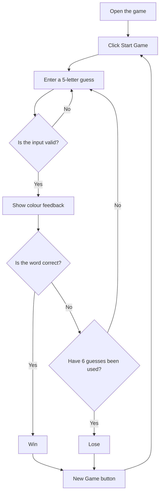

# Wordle Game

## Project overview

This is a small Wordle-style game made with HTML, CSS and JavaScript. The player has six chances to guess a five-letter word. Green means a letter is in the right place, yellow means it is in the word but in the wrong place, and grey means it is not in the word.

**Extra feature:** A timer counts how many seconds the player takes. It stops when the player wins or loses.

## Target audience and user profile

The game is for people who like short, simple word games and want to play on a computer or phone.

Example user profile: Alex is a university student who wants a quick game to play during a break. Alex wants instructions that are easy to understand and clear feedback after every guess.

## Requirements

| ID | Requirement | Type |
|---|---|---|
| F1 | The player can start a new game | Functional |
| F2 | The player can enter a five-letter guess | Functional |
| F3 | The game shows green, yellow and grey feedback | Functional |
| F4 | The player gets six attempts | Functional |
| F5 | The game shows a win or lose message | Functional |
| F6 | A timer tracks time and stops at the end | Functional (extra) |
| N1 | The page should be easy to understand | Non-functional |
| N2 | The player should be able to use the Enter key | Non-functional |
| N3 | The layout should work on a small screen | Non-functional |

## Design

I kept the layout simple so the main part of the page is the guessing grid.

Initial layout sketch:

```text
          WORDLE GAME
         Time: 0 seconds
          Guesses: 0/6

         [ ][ ][ ][ ][ ]
         [ ][ ][ ][ ][ ]
         [ ][ ][ ][ ][ ]
         [ ][ ][ ][ ][ ]
         [ ][ ][ ][ ][ ]
         [ ][ ][ ][ ][ ]

      Your guess: [_____] [Guess]
            [Start Game]

         Colour instructions
```

Game flow:




## Pseudocode

```text
WHEN Start Game is clicked
    Pick a random word
    Set guesses to 0
    Start the timer
    Clear the grid

WHEN the player submits a guess
    IF it is not exactly 5 letters
        Show an error message
    ELSE
        Check letters in the correct position
        Check remaining letters in the wrong position
        Show the colours in the grid
        Add 1 to guesses
        IF guess is correct
            Show win message and stop timer
        ELSE IF guesses = 6
            Show lose message and stop timer
        END IF
    END IF
```

## How the Worlde game  was built and what i included

- `index.html` contains the headings, buttons, input box and game area.
- `style.css` makes the word grid and adds the colours.
- `script.js` chooses a word, checks guesses, updates the screen and runs the timer.

The game uses simple functions and JavaScript DOM methods such as "getElmentById", "createdElement", and "textContent" 

I used an iterative/prototyping approach: make a small working version, test it, then improve one feature at a time. 


## Testing plan and evidence

After you run each test yourself, fill in the **Actual result** and **Status** columns. Do not submit planned tests as if they have already passed.

| Test | Expected result | Actual result | Status |
|---|---|---|---|
| Start game | Empty grid appears, input is enabled | To complete | Not tested |
| Enter fewer than 5 letters | Error message; attempt not used | To complete | Not tested |
| Enter numbers | Error message; attempt not used | To complete | Not tested |
| Guess correct word | Green letters, win message, timer stops | To complete | Not tested |
| Use all 6 attempts | Lose message with correct word | To complete | Not tested |
| Click New Game | Grid, guesses and timer reset | To complete | Not tested |
| Press Enter | Submits a guess | To complete | Not tested |

## Technical challenge

Problem Encountered:

Before uploading my Wordle project to GitHub, I had a problem getting the website to display correctly. When I opened the HTML file in my browser, the page appeared completely white, the text was not centred, and none of the CSS styling was working. This was frustrating because I had the files ready, but the game wasn't displaying how it was supposed to.

Possible Solutions:
I considered checking whether the CSS file was linked correctly in the HTML, whether the file names matched, and whether all the files were stored in the correct folder.

Solution Implemented:
I eventually realised that I had been opening the HTML file directly from the ZIP file instead of extracting the folder first. I extracted the ZIP file, made sure the HTML, CSS and JavaScript files were together, and reopened the HTML file in my browser.

Testing and Outcome:
After extracting the files, I tested the website again. This time, the CSS loaded properly, and the game displayed the correct layout, colours and buttons. I was then able to continue preparing my project for GitHub.

What I Learned:
This problem took more effort than I expected, but it helped me understand how HTML files connect to external CSS and JavaScript files. I also learned that checking file locations and testing locally before uploading a project to GitHub is important.


## Limitations and possible improvements

- The game uses a short built-in list of possible answers.
- It accepts any five letters as a guess, even if they do not form a real word.
- It does not save scores between visits.

A future version could use a bigger word list and a keyboard on screen.

